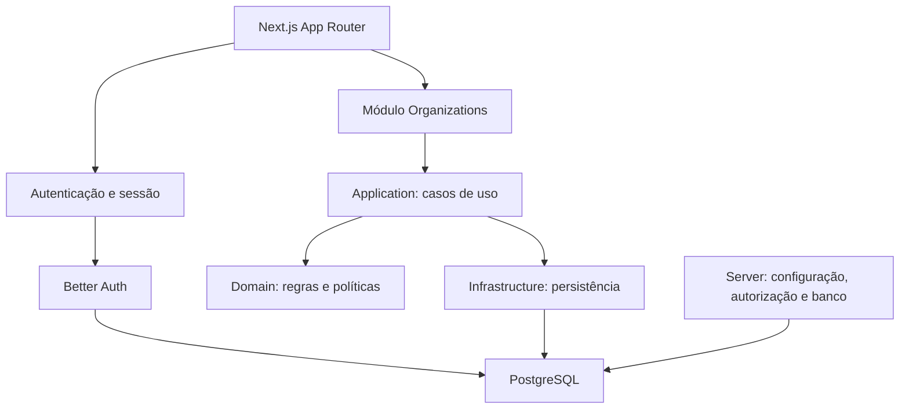

# RoutePay

### Enterprise Payments Platform — Em desenvolvimento

O **RoutePay** é um projeto de engenharia de software voltado à construção de uma plataforma empresarial de pagamentos com stablecoins.

A visão do produto contempla organizações, fornecedores, carteiras, aprovações, execução não custodial, reconciliação e comprovantes. **Essas funcionalidades financeiras ainda não foram implementadas.**

A implementação atual concentra-se na fundação da aplicação: autenticação real, gerenciamento inicial de organizações, persistência em PostgreSQL, autorização no servidor e arquitetura modular.

**Tecnologias principais:** Next.js 16 · React 19 · TypeScript · PostgreSQL · Better Auth · Vitest

> **Status:** fundação e primeira entrega de organizações implementadas. Sem pagamentos reais, integração blockchain, ambiente de produção ou deploy público.

---

## Funcionalidades implementadas

### Autenticação e acesso

- Integração com Better Auth e Google OAuth.
- Login e logout utilizando os handlers oficiais da biblioteca.
- Dashboard protegido por validação de sessão no servidor.
- Sessões com duração máxima de oito horas, sem renovação automática.
- Negação de acesso quando a configuração, o banco de dados ou a sessão estão indisponíveis.
- Ausência de autenticação fictícia para contornar os controles de acesso.

### Organizações

- Criação de organizações.
- Listagem de organizações autorizadas.
- Consulta dos dados básicos de uma organização.
- Associação de organizações a usuários autenticados.
- Validação de identidade e autorização no servidor.
- Persistência em PostgreSQL.
- Row-Level Security (RLS) nas tabelas `organizations` e `organization_memberships`.

A primeira organização foi criada e consultada em um fluxo HTTP autenticado validado manualmente no ambiente local.

**Ainda não estão implementados:** convites, administração de membros, transferência de propriedade, paginação e auditoria operacional.

### Rotas disponíveis

| Rota | Responsabilidade |
| --- | --- |
| `/` | Página institucional pública |
| `/login` | Entrada com Google OAuth, quando configurado |
| `/dashboard` | Área administrativa protegida |
| `/dashboard/organizations` | Criação e listagem de organizações |
| `/dashboard/organizations/[organizationId]` | Consulta de organização autorizada |
| `/api/auth/[...all]` | Handlers GET/POST do Better Auth |

---

## Stack tecnológica

| Camada | Tecnologias |
| --- | --- |
| Aplicação web | Next.js 16, React 19, App Router |
| Linguagem | TypeScript em modo estrito |
| Interface | Tailwind CSS 4 |
| Autenticação | Better Auth 1.7.18, Google OAuth |
| Banco de dados | PostgreSQL 18.6, driver `pg` 8.23.1 |
| Testes | Vitest 5 e testes de integração PostgreSQL |
| Qualidade | ESLint 9, Prettier |
| Ambiente | Node.js 24, npm 11, WSL/Linux |

A aplicação utiliza o driver PostgreSQL diretamente, sem ORM adicional.

As dependências diretas estão fixadas no `package.json`, e o `package-lock.json` está versionado.

---

## Arquitetura

O RoutePay adota uma arquitetura de **monólito modular**, com separação entre responsabilidades de apresentação, aplicação, domínio e infraestrutura.



O diagrama é uma representação conceitual das responsabilidades implementadas, não um mapa exaustivo de chamadas ou dependências de código.

### Organização dos módulos

```text
src/
  app/                    Rotas, layouts e composição
  components/             Componentes visuais compartilhados
  modules/
    identity/             Apresentação de autenticação
    organizations/
      domain/             Regras e políticas
      application/        Casos de uso
      infrastructure/     Persistência e serviços
      presentation/       Interface do módulo
    counterparties/       Reservado para evolução futura
    wallets/              Reservado para evolução futura
    payments/             Reservado para evolução futura
    reconciliation/       Reservado para evolução futura
    receipts/             Reservado para evolução futura
    audit/                Reservado para evolução futura
  integrations/           Reserva para adaptadores futuros
  server/
    auth/                 Configuração de autenticação
    authorization/        Controles de acesso
    db/                   PostgreSQL e migrations
    config/               Configuração do servidor
  shared/                 Utilitários compartilhados

db/migrations/            Migrations SQL versionadas
scripts/database.mts      Ferramentas de banco de dados
tests/                    Testes e fixtures
docs/                     Documentação técnica
```

**Importante:** diretórios reservados com `.gitkeep` não representam funcionalidades implementadas.

Consulte [a documentação da arquitetura](docs/architecture/foundation.md).

---

## Segurança e integridade de dados

A implementação atual incorpora controles voltados à segurança da fundação da aplicação.

### Sessões e autorização

- Sessões verificadas no servidor.
- Autorização aplicada nas operações de organizações.
- A identidade do usuário não é determinada por parâmetros fornecidos pelo navegador.
- Acesso negado quando a sessão é inválida, expirada ou indisponível.

### PostgreSQL

- Separação entre `routepay_app` e `routepay_migrator`.
- Credenciais de aplicação sem privilégios de execução de migrations.
- Migrations versionadas com validação de alvo e checksum.
- RLS habilitada nas tabelas de organizações e vínculos.
- Integridade relacional e permissões verificadas em testes de integração.

**Limitação importante:** a credencial `routepay_app` pode definir o contexto customizado utilizado nas políticas RLS. Portanto, a validação da sessão e da identidade no servidor permanece indispensável. RLS, isoladamente, não constitui uma fronteira de segurança suficiente contra comprometimento da aplicação.

Esses controles não equivalem a uma auditoria independente de segurança nem tornam o projeto pronto para produção.

---

## Testes e evidências

O projeto diferencia testes com dependências simuladas, integração com PostgreSQL real e validação manual de fluxos HTTP.

| Nível | Evidência documentada | Limitação |
| --- | --- | --- |
| Testes unitários | Ambiente, sessões, políticas, casos de uso e contratos | Não executam OAuth completo nem substituem testes com banco real |
| Integração PostgreSQL | 52 cenários aprovados em cluster isolado | Não demonstram segurança ou comportamento de produção |
| Fluxo HTTP autenticado | Criação, listagem e consulta de organização verificadas manualmente | Não existe suíte HTTP end-to-end automatizada para esse fluxo |
| Build e qualidade | Scripts de lint, typecheck, formatação, testes e build | Precisam ser executados no ambiente de quem estiver avaliando |

Os **52 cenários de integração PostgreSQL** abrangem, entre outros, RLS, permissões, integridade, Unicode, rollback e concorrência.

Esses resultados são provenientes da documentação do projeto. Não foram reexecutados durante a preparação deste README.

Documentação complementar:

- [Testes de integração de organizações](docs/testing/organizations-integration.md)
- [Arquitetura e autorização de organizações](docs/architecture/organizations.md)

### Executar validações

```bash
npm run format:check
npm run lint
npm run typecheck
npm test
npm run build
```

O comando `npm run check` executa as quatro primeiras verificações em sequência. O build deve ser executado separadamente.

---

## Instalação e execução local

### Pré-requisitos

- Node.js 24.x
- npm 11.x
- Acesso ao registro npm
- PostgreSQL 18.6 local para os fluxos autenticados

A página pública, os testes unitários e o build podem funcionar sem configurar o banco ou credenciais OAuth. O dashboard autenticado depende desses serviços.

### Instalação

```bash
git clone https://github.com/vinicius-santos-luz/routepay.git
cd routepay
nvm use
npm ci
```

O comando `nvm use` pressupõe que o NVM esteja instalado.

### Configuração de ambiente

```bash
cp .env.example .env.local
```

Variáveis relevantes:

| Variável | Finalidade |
| --- | --- |
| `APP_ENV` | Ambiente local ou de testes |
| `DATABASE_URL` | Conexão da aplicação com `routepay_app` |
| `MIGRATION_DATABASE_URL` | Conexão exclusiva do executor de migrations |
| `BETTER_AUTH_URL` | Origem configurada da aplicação |
| `BETTER_AUTH_SECRET` | Segredo local de autenticação |
| `GOOGLE_CLIENT_ID` | Identificador OAuth do Google |
| `GOOGLE_CLIENT_SECRET` | Segredo OAuth do Google |

Não existem valores padrão para credenciais de banco ou segredo de autenticação.

**Não reutilize a credencial do migrator na aplicação.** O executor de migrations recebe sua própria variável de ambiente e não carrega `.env.local` automaticamente.

As migrations `0001` e `0002` já foram aplicadas nos ambientes locais documentados. Não as edite nem reaplique manualmente. Para configurar um ambiente novo, siga o procedimento de preparação e confirmação do alvo antes de executar qualquer migration.

Consulte [a documentação de autenticação e PostgreSQL](docs/architecture/authentication.md).

### Iniciar a aplicação

```bash
npm run dev
```

Acesse:

- `http://localhost:3000`
- `http://localhost:3000/login`

Para executar a versão compilada localmente:

```bash
npm run build
npm start
```

Isso não realiza deploy.

---

## Ambientes de banco documentados

O desenvolvimento utiliza dois clusters PostgreSQL locais e separados.

| Finalidade | Cluster | Porta | Banco |
| --- | --- | --- | --- |
| Desenvolvimento | `18/main` | `5432` | `routepay_dev` |
| Integração isolada | `18/routepay_test` | `5433` | `routepay_dev` |

Ambos possuem as migrations `0001` e `0002` aplicadas, conforme a documentação de 08/11/2026.

Esses registros descrevem o ambiente utilizado no desenvolvimento e não significam que os mesmos serviços estejam disponíveis para quem clonar o repositório.

---

## Roadmap

As próximas capacidades previstas incluem:

- Convites e administração de membros de organizações.
- Cadastro e gerenciamento de fornecedores.
- Vínculo de carteiras e prova de posse.
- Intenções e aprovações de pagamentos.
- Integrações blockchain e execução não custodial.
- Reconciliação de transações.
- Comprovantes baseados em evidências de liquidação.
- Auditoria operacional, observabilidade e controles adicionais de segurança.

### Integrações financeiras

**Solana e MultiHopper fazem parte da visão futura do produto e não estão integrados.**

A integração MultiHopper depende de validação técnica sobre ativos suportados, comportamento da liquidação, recuperação de fundos e segurança de implantação.

Também não foram integrados Neon, Playwright ou infraestrutura de produção.

---

## Limitações atuais

- Não executa pagamentos reais.
- Não conecta carteiras blockchain.
- Não envia transações à Solana.
- Não utiliza MultiHopper.
- Não possui ambiente de produção nem deploy público.
- Não possui MFA ou administração completa de sessões.
- Não implementa convites ou administração de membros.
- Não possui suíte HTTP end-to-end automatizada.
- Não deve ser utilizado para custodiar fundos ou processar operações financeiras.

O RoutePay é um projeto em evolução. Cada módulo futuro exigirá implementação, testes, revisão de autorização e validação de segurança compatíveis com sua responsabilidade.

---

## Documentação técnica

- [Fundação do monólito modular](docs/architecture/foundation.md)
- [Autenticação e configuração](docs/architecture/authentication.md)
- [Organizações e autorização](docs/architecture/organizations.md)
- [Testes de integração PostgreSQL](docs/testing/organizations-integration.md)

---

**RoutePay — Projeto de engenharia de software em desenvolvimento.**

*Foco em arquitetura modular, autenticação, persistência, autorização e evolução incremental.*
